

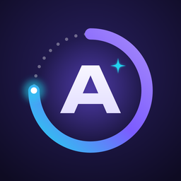

# Argos AI

**Your AI coach for any goal.**
Write a goal — Argos asks a few questions, builds a realistic plan with daily tasks, checks your reports and adapts to your energy.

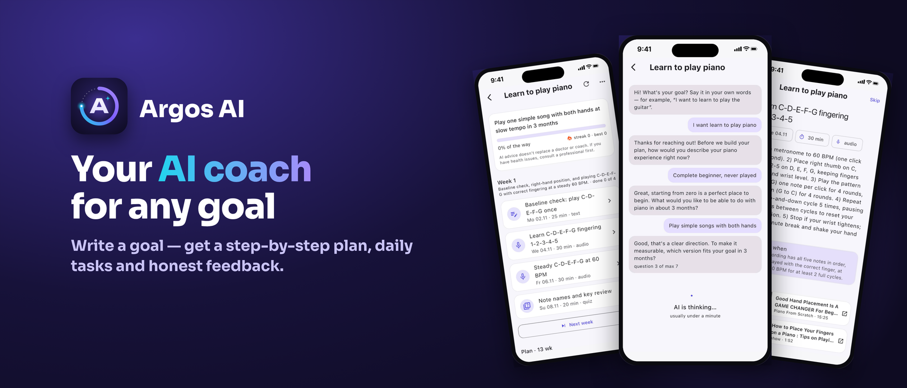

## What it does

| | |
|---|---|
| 🎯 **Goal → plan** | Tell it what you want — learn piano, lose belly fat, pass an exam. The AI asks a few clarifying questions and builds a week-by-week plan. |
| ✅ **Daily tasks** | Short tasks that fit your time and level, with videos, books and exercises picked for each one. |
| 📸 **Real feedback** | Report with text, photo or audio — the AI reviews the result and tells you what to fix. |
| 🌙 **Evening check-in** | Mood, energy, what got done. Every Sunday — a weekly review. |
| 🔄 **Adapts to you** | Tired week — lighter tasks. Strong week — a bit harder. |
| 🔥 **Streaks & achievements** | Streak freeze, 12 achievements, progress calendar and goal history. |
| 🌍 **10 languages** | English, Русский, Türkmençe, Türkçe, Español, Français, Deutsch, 中文, 日本語, 한국어 |

## Screenshots

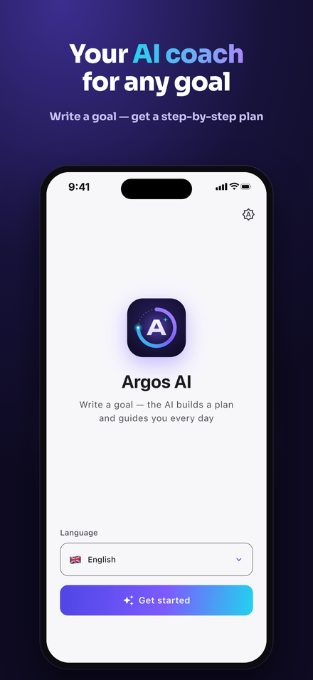 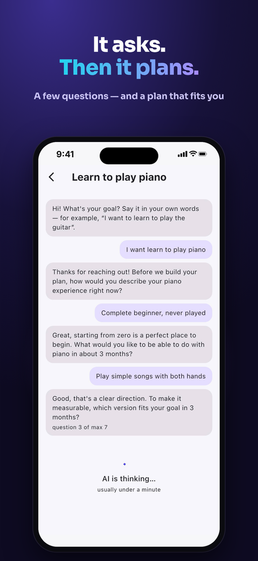 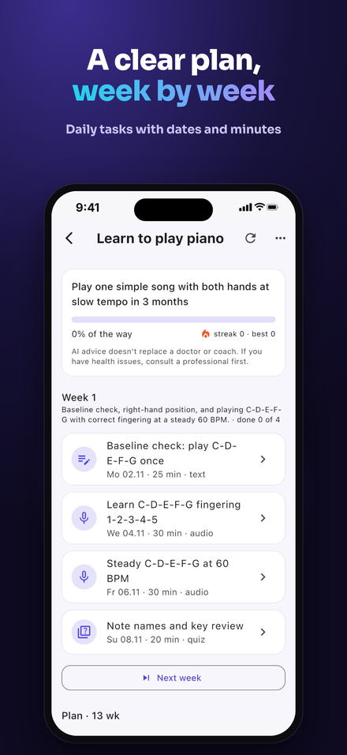 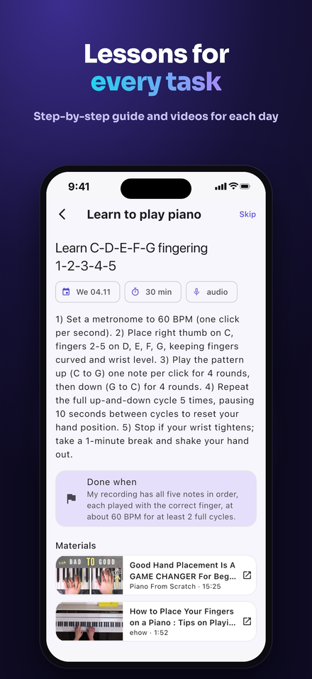 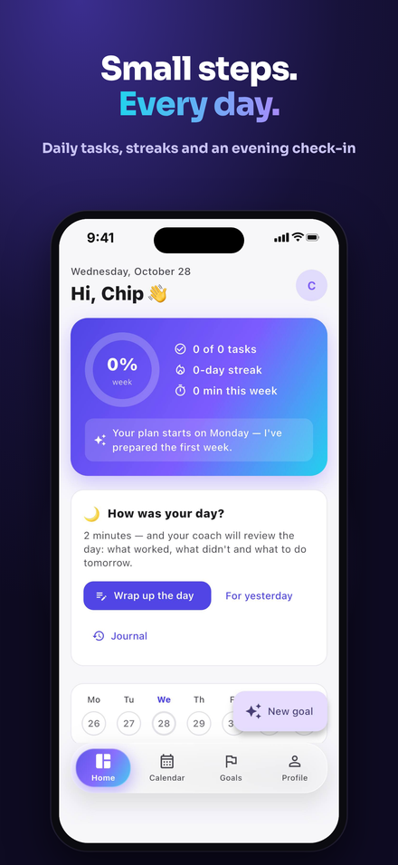
  
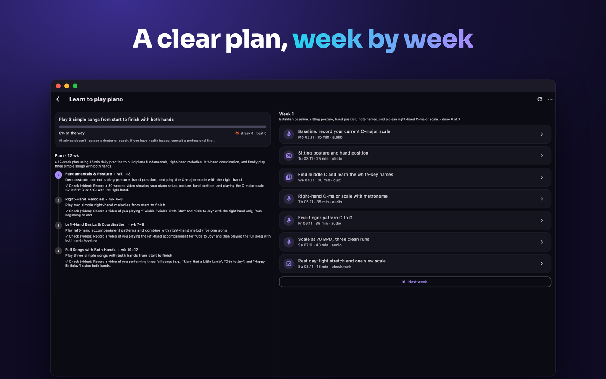 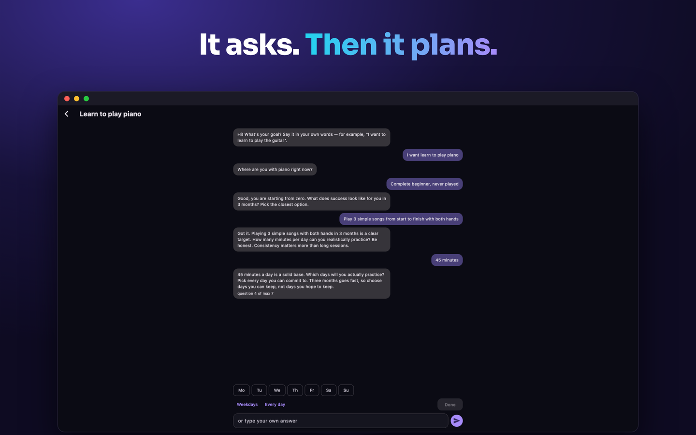
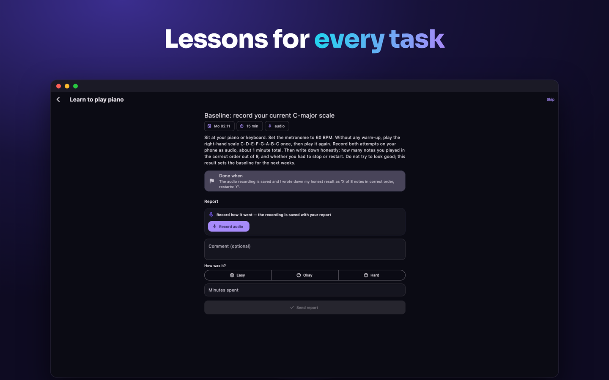 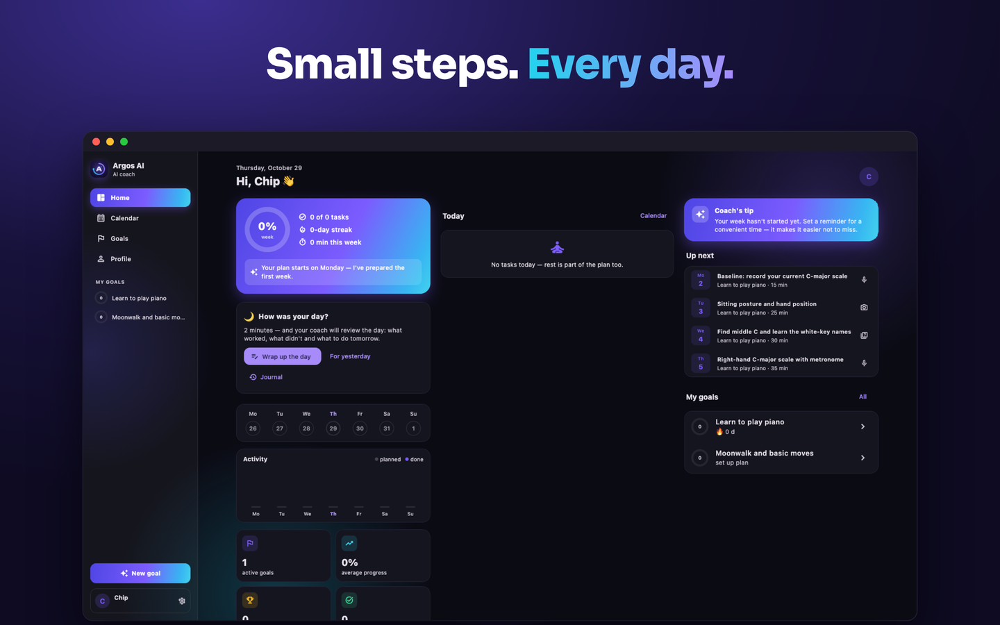

## Download

| Platform | How to get it |
|---|---|
| **iPhone** | [App Store](https://apps.apple.com/app/id6821904224) |
| **Mac** (Apple Silicon & Intel, macOS 12+) | [Mac App Store](https://apps.apple.com/app/id6821904224) |
| **Windows 10/11** (x64) | [`ArgosAI-Setup.exe` from Releases](https://github.com/Calteck20/argos-ai/releases/latest) |
| **Android** | Coming soon |

> **Windows note:** the installer is not code-signed yet, so Windows may show *“Windows protected your PC”*. Click **More info → Run anyway**.

## Privacy

Your data is never sold or used for ads. Delete your account and all data any time in **Profile → Delete account**.
[Privacy policy & support](https://claude.ai/artifact/TAfirSMBP3Vrb8Bk2nDXYC)

---

<b>🇷🇺 По-русски</b>

**Argos AI** — личный ИИ-коуч для любой цели. Напиши, чего хочешь добиться: Argos задаст пару вопросов, составит реальный план с заданиями на каждый день, проверит отчёты (текст, фото, аудио) и подстроится под твою энергию.

- iPhone и Mac — App Store
- Windows — установщик в [Releases](https://github.com/Calteck20/argos-ai/releases/latest)
- Android — скоро

Вопросы и идеи: **meylisbegowich@gmail.com**

Made in Ashgabat 🇹🇲 by <a href="https://github.com/Calteck20">Meylis Begov</a> · Support: meylisbegowich@gmail.com

